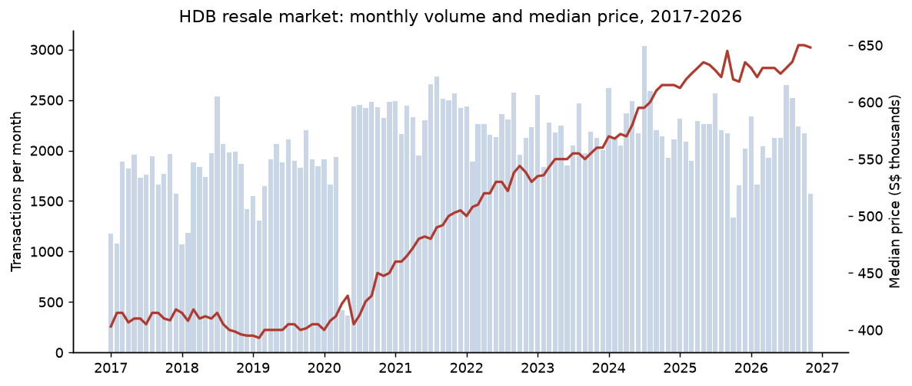
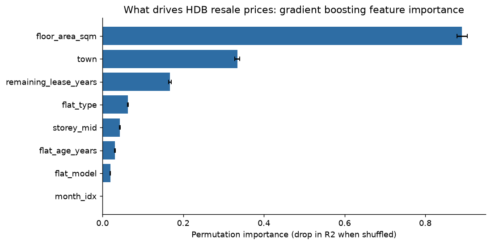

# HDB Resale Price Intelligence

**A freelance-style data analysis of Singapore's HDB resale market: what drives
prices, how accurately a machine can value a flat, how fast the market moved
from 2017 to 2026, and where flats transacted below model value.**

> **Disclosure: simulated client engagement.** This project is framed as a
> freelance data-analyst engagement for a Singapore proptech startup building
> an HDB home-valuation tool (see `CLIENT_BRIEF.md`). The client and the brief
> are a portfolio simulation; there is no real client. **The data, methods and
> results are entirely real**, built from 245,123 official HDB resale
> transactions published by data.gov.sg.



## Executive summary (client-facing)

**The market.** The median HDB resale flat cost **S$410,000 in 2017** and
**S$628,000 in 2025**, a rise of about 53% in nominal terms, reaching
S$635,000 in January–November 2026. Volume peaked in 2021 (29,057
transactions) and has settled around 25,000–28,000 a year. The market's centre
of gravity is the 4-room flat: 104,256 of the 245,123 transactions (43%).

**Million-dollar flats are no longer a curiosity.** In 2017, 46 transactions
(0.23%) crossed S$1 million. In 2024, the latest full pre-test year, it was
1,035 (3.72%); in 2025, 1,591 (6.35%); and in January–November 2026 alone,
1,884 (8.06%). Cumulatively 5,869 flats have sold for S$1 million or more
since 2017. They are concentrated in mature central towns: 21.4% of all
Central Area transactions and 10.4% of Queenstown transactions crossed
S$1 million, while Jurong West and Choa Chu Kang recorded none at all.

**Location is a price-per-square-metre story.** By median price per sqm, the
most expensive towns are Central Area (S$7,732/sqm), Queenstown (S$7,579) and
Bukit Merah (S$7,000). The most affordable are Jurong West (S$4,609/sqm),
Woodlands (S$4,664) and Choa Chu Kang (S$4,731). Queenstown also posts the
highest median price overall (S$680,000); the cheapest median prices are in
Jurong West (S$465,000) and Woodlands (S$472,000).

**What drives price.** In the valuation model, floor area is by far the
strongest driver, then town, then remaining lease. Each additional square
metre is associated with about +0.8% on price in the hedonic model, each
additional year of remaining lease with about +1.0%, and higher storeys add a
smaller premium. Flat model (DBSS, Premium Apartment, Maisonette, …) matters,
but far less than size, town and lease.

**Lease decay is real but easy to misread.** Raw medians by remaining-lease
band look non-monotonic (flats with 60–69 years left show *lower* median
price per sqm than flats with 40–49 years left) because the bands mix
different towns and flat sizes: the 60–69 band is full of large flats in
cheaper towns, the 40–49 band of small flats in central ones. Holding the
other attributes constant in the hedonic model gives the cleaner estimate:
roughly **+1.0% of price per additional year of remaining lease**. A valuation
product that quotes raw band medians would mislead its users; this is exactly
the kind of artefact the model-based view exists to correct.

**How accurate can automated valuation be?** Trained on transactions up to
December 2024 and tested on 48,437 transactions from January 2025 onward (a
true forward-looking test), a gradient boosting model prices the typical flat
within **5.8% (MAPE)** of its transacted price, with a mean absolute error of
S$41,038 and R² of 0.915. A transparent hedonic linear model is close behind
at 8.0% MAPE (R² 0.889). Accuracy is best for 2-room flats (5.0% MAPE) and
worst among the common types for 5-room flats (6.1%). The two rarest types
(1-room and multi-generation, 14 test transactions each) are too thin to
evaluate and should be excluded from any accuracy promise.

**Where the market disagrees with the model (2026).** Comparing 2026
transactions with model predictions, the segments priced furthest *below* the
model are Toa Payoh 3-room (median −3.6% vs prediction, 376 transactions),
Yishun 4-room (−2.7%, 717 transactions) and Jurong East 4-room (−2.3%).
Segments priced furthest *above* the model are Queenstown 5-room (+14.3%),
Central Area 3-room (+11.6%) and Serangoon Executive (+9.6%): buyers pay a
premium there that recorded attributes do not explain, plausibly renovation,
view and micro-location. These gaps are **relative to the model, not
investment advice**: a segment below the model can reflect unrecorded
condition rather than a bargain.

## Product recommendations for the startup

1. **Ship the gradient boosting model as the valuation engine, show the
   linear model as the explanation layer.** The boosting model is the more
   accurate pricer; the hedonic coefficients ("+1.0% per year of lease",
   "+0.8% per sqm") are what users can actually understand and trust.
2. **Quote an honest accuracy band, per flat type.** "Within about 6% for
   most 3/4/5-room flats" is defensible from the forward test; a single
   market-wide number hides that Executive flats and rare types are harder.
3. **Never show raw lease-band medians in the product.** They are confounded
   by town and size mix (see above). Show the model-based lease curve instead.
4. **Treat million-dollar segments as a distinct product surface.** At 8% of
   2026 transactions and rising, premium flats in Queenstown, Central Area and
   Bukit Merah behave differently enough to deserve their own comparables
   logic and their own accuracy reporting.
5. **Flag "above-model" listings rather than hiding them.** A persistent
   positive gap in a segment signals attributes the data cannot see
   (renovation, view). Prompting sellers for those attributes would improve
   both the product and future model training data.
6. **Retrain on a rolling window and re-test forward.** The model here was
   trained once on ≤2024 data; by late 2026 its test window is nearly two
   years old. A quarterly retrain with a fresh forward holdout keeps the
   published accuracy honest.



## The four brief questions, answered

| # | Question | Answer in one line |
|---|----------|--------------------|
| 1 | What drives prices? | Floor area first, then town, then remaining lease (+~1.0%/year); storey and flat model are secondary. |
| 2 | How accurate is automated valuation? | Gradient boosting: 5.8% MAPE, R² 0.915 on a forward test of 48,437 transactions (2025–2026). Linear hedonic: 8.0% MAPE. |
| 3 | Where did the market move fastest? | Median price +53% from 2017 to 2025; million-dollar share rose from 0.23% (2017) to 6.35% (2025) and 8.06% (Jan–Nov 2026), concentrated in Central Area, Queenstown and Bukit Merah. |
| 4 | Lease decay and value segments? | About +1.0% of price per extra year of remaining lease, model-based; Toa Payoh 3-room and Yishun 4-room transacted furthest below model value in 2026. |

## Methods

- **Cleaning** (`scripts/02_clean.py`): storey ranges converted to mid-storey
  (e.g. "04 TO 06" → 5); remaining-lease text ("61 years 04 months", "63
  years") parsed to decimal years; flat age derived as registration year minus
  lease commence year; price per sqm derived. 318 exact-duplicate rows were
  dropped (see limitations) and no rows had impossible prices or areas.
  Final dataset: **245,123 transactions, Jan 2017 – Nov 2026, 26 towns**.
- **Market overview** (`scripts/03_market_overview.py`): monthly volume and
  medians, town league table, flat-type mix by year.
- **Million-dollar and lease analysis** (`scripts/04_lease_and_million.py`):
  transactions ≥ S$1,000,000 by year and town × year; median price per sqm by
  remaining-lease band (<40, 40–49, …, 90+ years).
- **Model** (`scripts/05_model.py`): target log(price). Features: floor area,
  mid-storey, remaining lease years, flat age, month index, and one-hot town,
  flat type and flat model. Two models: hedonic linear regression and
  histogram gradient boosting (500 iterations). **Time-based split: train on
  registrations up to 2024-12 (196,686 rows), test on 2025-01 onwards
  (48,437 rows).** Metrics: MAE, MAPE, R² overall and by flat type; feature
  importance by permutation on an 8,000-row test sample (5 repeats);
  value segments from 2026 residuals aggregated by town × flat type with a
  30-transaction minimum per cell.
- **Charts and dashboard** (`scripts/06_charts.py`, `scripts/07_dashboard.py`)
  are generated from the result tables only, never from hand-typed numbers.

## Charts

| Chart | File |
|-------|------|
| Monthly volume and median price | `charts/monthly_price_volume.png` |
| Median price per sqm by town | `charts/town_price_per_sqm.png` |
| Lease decay curve (raw band medians) | `charts/lease_decay_curve.png` |
| Predicted vs actual (2026) | `charts/predicted_vs_actual.png` |
| Million-dollar share by year | `charts/million_dollar_share.png` |
| Feature importance | `charts/feature_importance.png` |

## File guide

```
CLIENT_BRIEF.md                  Simulated client brief, scope, deliverables
README.md                        This report
scripts/
  01_download.py                 data.gov.sg download (open API, CKAN fallback)
  02_clean.py                    Cleaning + cleaning_log.json
  03_market_overview.py          Monthly series, town table, flat-type mix
  04_lease_and_million.py        Lease decay + million-dollar tables
  05_model.py                    Models, metrics, importance, value segments
  06_charts.py                   All charts
  07_dashboard.py                dashboard/index.html generator
data/
  raw/                           Source CSV (regenerable via script 01)
  processed/hdb_resale_clean.csv Cleaned transactions (245,123 rows)
  results/                       All result tables + summary.json
charts/                          Six PNG charts
dashboard/index.html             Generated client dashboard
tests/test_project.py            Consistency tests (12 tests)
```

## Data honesty and limitations

- **One official source.** All figures come from the data.gov.sg dataset
  "Resale flat prices based on registration date from Jan-2017 onwards"
  (dataset id `d_8b84c4ee58e3cfc0ece0d773c8ca6abc`), downloaded 24 Nov 2026.
  Prices are **nominal SGD**, not adjusted for inflation; part of the
  2017→2026 rise is general price inflation.
- **Registration date, not completion date.** "Month" is when the resale
  application was registered with HDB. 2026 covers January–November only.
- **HDB's own exclusions.** HDB notes that the published transactions exclude
  resales that may not reflect the full market price, such as sales between
  relatives or of part shares. The dataset is therefore already filtered
  toward arm's-length transactions.
- **Block-level location only.** The data identifies town, block and street,
  not the unit. Renovation quality, view, exact floor-level amenities, noise
  and walking distance to MRT or schools are not recorded; they live in the
  model's residual error (about 5.8% MAPE) and in the "above-model" segments.
- **Remaining lease is as recorded at registration.** It is taken from the
  published field and parsed to decimal years; it is not recomputed from the
  lease commencement date.
- **Duplicates caveat.** 318 rows were exact duplicates on every published
  field and were dropped as repeated records. Because the source publishes no
  unit number, a small number of these could in principle be distinct flats in
  the same block sold in the same month on identical terms; at 0.13% of the
  data this cannot move any headline figure.
- **Rare flat types.** 1-room (89 transactions in a decade) and
  multi-generation (94) flats are too rare for per-type accuracy claims; their
  test-set metrics are reported for completeness and should not be quoted.
- **Model-relative ≠ undervalued.** "Below the model" segments are priced
  below what flats with the same *recorded* attributes transacted at. This is
  a screening signal for a product, not investment advice and not a claim
  that any individual flat is mispriced.
- **The client is simulated; the analysis is not.** The proptech startup and
  its brief are a portfolio framing device, disclosed here and in
  `CLIENT_BRIEF.md`. No number in this project is simulated.

## Reproduce

```bash
python3 -m venv .venv
.venv/bin/pip install -r requirements.txt
.venv/bin/python scripts/01_download.py
.venv/bin/python scripts/02_clean.py
.venv/bin/python scripts/03_market_overview.py
.venv/bin/python scripts/04_lease_and_million.py
.venv/bin/python scripts/05_model.py
.venv/bin/python scripts/06_charts.py
.venv/bin/python scripts/07_dashboard.py
.venv/bin/python -m pytest tests/ -q   # 12 tests
```
